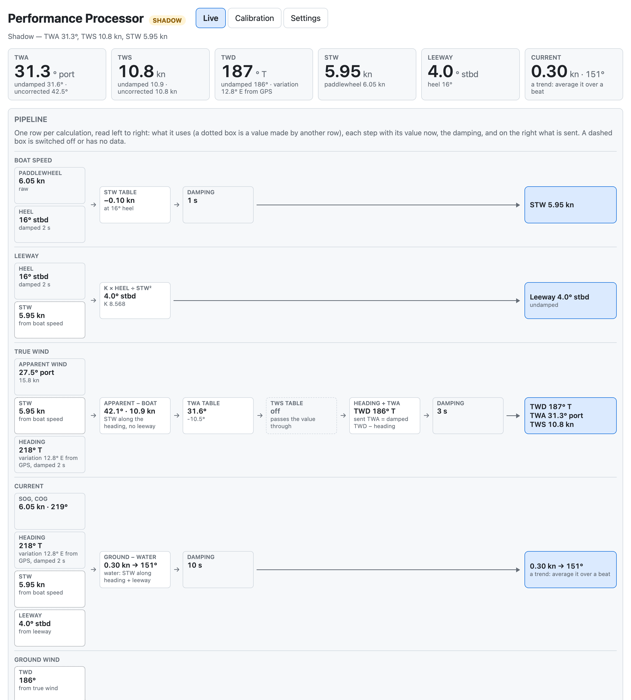
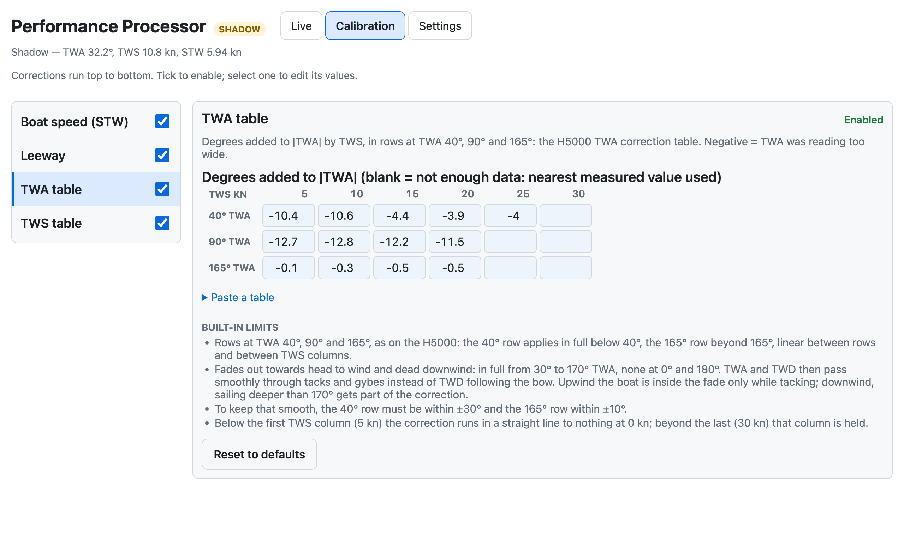
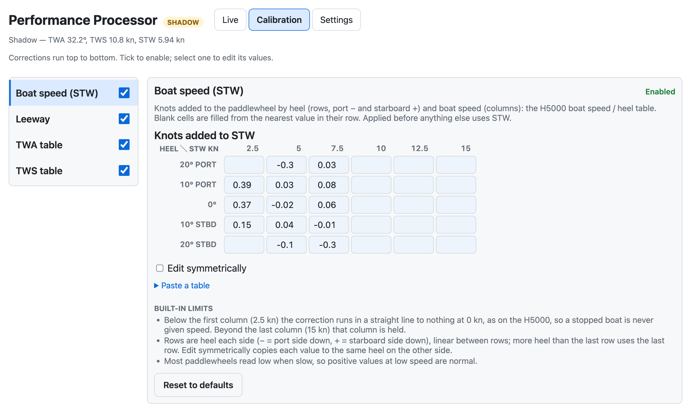
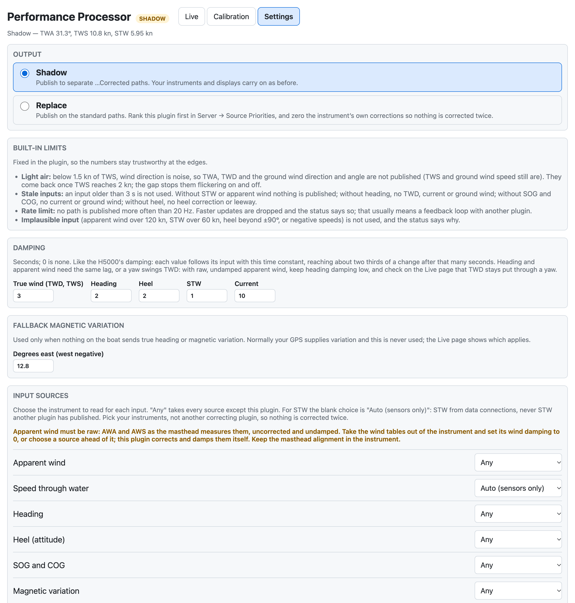
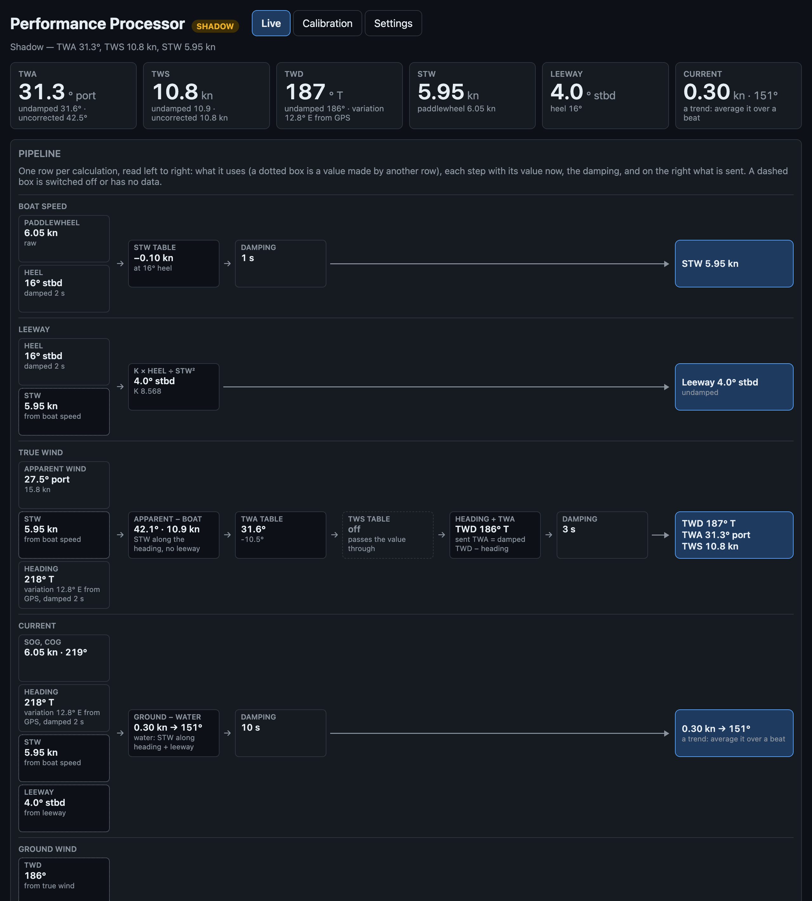
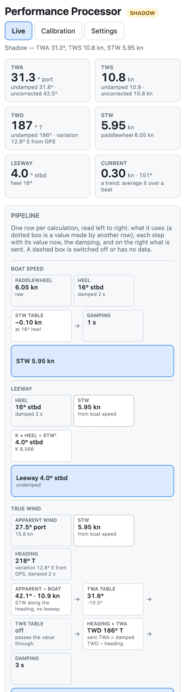

# signalk-performance-processor

**Steady true wind direction through tacks and gybes: true wind calibrated in Signal K, the way a B&G H5000 does it.**

**The problem.** If your TWD swings 5–10° every time you tack or gybe, the wind hasn't shifted: your true wind is miscalibrated. True wind is worked out from apparent wind, boat speed and heading, so it inherits their errors. The masthead reads a bent airflow upwind, the paddlewheel misreads when heeled, and neither error is the same on both tacks. You can't call real shifts, laylines land in the wrong place, and polars and targets get bad numbers.

**What it does.** It works out true wind again in Signal K from raw apparent wind, boat speed and heading, and corrects it as an H5000 does: a boat speed / heel table, then TWA and TWS correction tables, then damping. It publishes corrected TWA, TWS and TWD, with boat speed, leeway, current and ground wind.

**How it is calibrated.** From your own sailing. TWD should not change when the boat tacks or gybes, so every manoeuvre in your logs measures how far TWA is out; boatcal's [`plugincal`](https://github.com/ghotihook/boatcal/tree/main/plugincal) fits the tables from them, and the GPS fits the boat speed table. Paste the result into the webapp, watch each step work live, and run it in **Shadow mode** beside your instruments until you trust it.



## Features

- **The H5000's tables, in the H5000's layout**: boat speed / heel, TWA and TWS. An H5000 calibration can be typed or pasted in cell for cell.
- **Fitted from your own logs** by `plugincal`, and pasted straight into the webapp.
- **Every step visible live**: what each calculation uses, what each correction changed, and what is sent.
- **Damping as on the H5000**, set separately for heading, heel, true wind, boat speed and current.
- **Safe to try**: Shadow mode publishes separate `…Corrected` paths and changes nothing else.
- **Leeway, current and ground wind** as well as true wind.
- **A plain JSON configuration**, easy to back up and compare.

## Requirements

- A Signal K server (2.x) on Node 18 or newer. Replace mode uses the server's **Source Priorities**.
- These inputs in Signal K:

| Input | Path | Needed for |
|---|---|---|
| Apparent wind, **raw** | `environment.wind.angleApparent`, `speedApparent` | everything |
| Boat speed | `navigation.speedThroughWater` | everything |
| Heading | `navigation.headingTrue`, or `headingMagnetic` with `navigation.magneticVariation` | TWD, current, ground wind |
| Heel | `navigation.attitude` (roll) | the STW table's heel rows, leeway |
| SOG, COG | `navigation.speedOverGround`, `courseOverGroundTrue` | current, ground wind |

> **Apparent wind must be raw: AWA and AWS as the masthead measures them, uncorrected and undamped.** The plugin applies the calibration and the damping itself. Wind that an instrument has already corrected gets corrected twice, and wind it has already damped lags heading and boat speed, so TWD swings with every yaw. In the instrument, take the wind tables out and set wind damping to 0, or read apparent wind from a source ahead of it. Masthead alignment (an offset fixed on the sensor) is the exception: keep it in the instrument.
>
> **Boat speed** is the paddlewheel with the instrument's boat speed calibration (its speed factor) and nothing else: no heel correction in the instrument.

## Installation

1. In the Signal K admin UI, **Appstore → Available**, search for **Performance Processor**, **Install**, and restart the server when asked.
2. **Server → Plugin Config**: enable **Performance Processor** (it ships disabled).
3. Open **Webapps → Performance Processor**. It starts in Shadow mode with the defaults.

## Getting started

1. **Check the inputs.** The Live page lists every input with its source and age. If more than one instrument sends the same thing, choose one under **Settings → Input sources**.
2. **Calibrate.** Log some sailing since your setup last changed (rig tune, sails, instrument calibration): 10 or more tacks and gybes in steady wind, some reaching and a few roundings. Run `python -m plugincal --since <that date>` ([how](https://github.com/ghotihook/boatcal/tree/main/plugincal)), paste each table it prints into the **Calibration** page, and **Save**. By hand, the H5000 rule works unchanged: if TWD lifts on every tack, take half the error off TWA in that cell.
3. **Compare.** Sail in Shadow mode and compare the `…Corrected` paths with your instruments.
4. **Go live** with Replace mode once you trust it: rank this plugin first for each output path in **Server → Source Priorities**, and take the instrument's own TWA / TWS tables out so nothing is corrected twice.

Refit after anything that changes the boat or what the instruments read: a rig tune, new sails, a boat speed calibration change, a new masthead unit.

## How it works

One chain per calculation, from its inputs to what it sends. Inputs in *italics* are made by another chain. The Live page shows the same chains with each value now.

| Chain | Uses | Steps | Sends |
|---|---|---|---|
| Boat speed | paddlewheel, heel | STW table → damping | STW |
| Leeway | heel, *STW* | K × heel ÷ STW² | leeway |
| True wind | apparent wind, *STW*, heading | apparent wind − STW along the heading → TWA table → TWS table → heading + TWA → damping | TWD, TWS, and TWA as the damped TWD less the heading |
| Current | SOG, COG, heading, *STW*, *leeway* | ground velocity − water velocity → damping | current |
| Ground wind | *TWD*, *TWS*, *current* | true wind + current → damping | ground wind speed, direction and angle |

| Correction | What it does | Default |
|---|---|---|
| STW table | Knots added to the paddlewheel, by heel (rows 0, 10, 20°, either side) and boat speed (columns 0, 5 … 30 kn), bilinear. Fades out below 1 kn, so a stopped boat is not given speed | On |
| Leeway | K × heel ÷ STW², capped at 15°, faded in from 1.5 to 3 kn. Used for current, **not** for true wind, as on the H5000 by default: the TWA table takes up its effect | On |
| TWA table | Degrees added to \|TWA\|, in rows at TWA 40°, 90° and 165° by TWS 0, 5 … 30 kn, linear between. In full from 30° to 170° TWA, fading to none at 0° and 180°, so TWD passes smoothly through tacks and gybes | On |
| TWS table | Knots added to TWS downwind, by TWS: none at 90° TWA or less, rising in a straight line to the full correction at the down angle (165° by default) | Off |

**Damping**, in seconds (0 = none), as on the H5000:

| Value | Default | |
|---|---|---|
| Heading | 2 s | Heading, before true wind |
| Heel | 2 s | Heel, before the STW table and leeway: takes most of the roll out |
| True wind | 3 s | TWD, TWS and ground wind. TWA is the damped TWD less the heading, so it answers the helm at once |
| STW | 1 s | The published STW |
| Current | 10 s | Current, as a vector |

More true wind damping gives a steadier TWD but shows a real shift later.

**Built in**, with the plugin's own numbers listed in the webapp:

- **Light air.** Below 1.5 kn of TWS, wind direction is noise: TWA, TWD and the ground wind direction and angle are not published (TWS and ground wind speed still are) until TWS is back to 2 kn.
- **Stale or implausible input.** Inputs older than 3 s are not used. Apparent wind over 120 kn, STW over 60 kn or heel beyond ±90° is ignored, and the status says why.
- **Heading.** `navigation.headingTrue` if present; otherwise magnetic heading plus `navigation.magneticVariation` (normally from the GPS); otherwise the fallback variation in Settings.
- **No loops with other plugins.** STW is read from sensors only (data connections, never another plugin) unless you choose a source in Settings, and no path is published more often than 20 Hz.

## The webapp

**Webapps → Performance Processor.**

- **Live**: the published values, with the undamped and uncorrected ones under them; the pipeline, one row per calculation; every path sent; each input's source and age.
- **Calibration**: the corrections in pipeline order, each with an on/off switch, its table, its built-in limits, **Paste a table** (the text `plugincal` prints, or the same from a spreadsheet), **Copy this table** and **Reset to defaults**. **Save** to apply.
- **Settings**: Shadow or Replace, damping, the fallback variation, and the source for each input.

| | |
|---|---|
|  |  |
|  |  |

On a phone each row stacks: 

## Outputs

| Output | Shadow mode (default) | Replace mode |
|---|---|---|
| True wind angle | `environment.wind.angleTrueWaterCorrected` | `environment.wind.angleTrueWater` |
| True wind speed | `environment.wind.speedTrueCorrected` | `environment.wind.speedTrue` |
| True wind direction | `environment.wind.directionTrueCorrected` | `environment.wind.directionTrue` |
| Speed through water (STW table on) | `navigation.speedThroughWaterCorrected` | `navigation.speedThroughWater` |
| Leeway (on) | `navigation.leewayAngleCorrected` | `navigation.leewayAngle` |
| Current | `environment.currentCorrected` | `environment.current` (`drift`, `setTrue`) |
| Ground wind speed | `environment.wind.speedOverGroundCorrected` | `environment.wind.speedOverGround` |
| Ground wind angle, from the bow | `environment.wind.angleTrueGroundCorrected` | `environment.wind.angleTrueGround` |
| Ground wind direction | `environment.wind.directionGroundCorrected` | `environment.wind.directionGround` (not in the Signal K schema; sent with `meta`) |

Everything is published under this plugin's own `$source`: STW each time the paddlewheel reports, the rest with each apparent wind update. Shadow paths carry `meta` with their units.

## Configuration

Everything is set in the webapp and saved to `config.json` in the plugin's data directory (`~/.signalk/plugin-config-data/signalk-performance-processor/`), not in the admin **Plugin Config** form. Saving needs write access when Signal K security is on. `plugincal --out` writes a complete `plugin_config.json` that can be copied there (then restart) or sent with `PUT /calibration`.

```json
{
  "schema": 3,
  "mode": "shadow",
  "variation": 12.8,
  "damping": { "heelS": 2, "headingS": 2, "trueWindS": 3, "stwS": 1, "currentS": 10 },
  "sources": { "apparentWind": "", "stw": "", "heading": "", "attitude": "", "gps": "", "variation": "" },
  "corrections": {
    "stw": { "enabled": true, "heel": [0, 10, 20], "stw": [0, 5, …, 30], "add": [[…], […], […]] },
    "leeway": { "enabled": true, "k": 8.568 },
    "twa": { "enabled": true, "tws": [0, 5, …, 30], "upwind": […], "reach": […], "downwind": […] },
    "tws": { "enabled": false, "tws": [0, 5, …, 30], "correction": […], "downAngle": […] }
  }
}
```

Blank table cells are `null`; the plugin uses the nearest value in the row. The table axes are fixed: a file with any other layout is refused with the reason, and so is a file from a newer release, which is never overwritten.

**The defaults are the author's boat** (before its 2026 rig tune), fitted by `plugincal`. They will be wrong for yours: refit, or use **Reset to defaults** and enter your own.

## Limitations

- **Your instrument displays show the instrument's numbers.** The plugin publishes into Signal K only. To see its values on the boat's displays, forward them to NMEA 2000 (for example with `signalk-to-nmea2000`). If you forward STW, choose your paddlewheel as the STW source in Settings: corrected STW coming back from the bus would otherwise look like a sensor and be corrected again.
- **The damping defaults were chosen on instrument-damped apparent wind.** With raw apparent wind, heading damping in particular may need to come down; set it so a yaw does not swing TWD on the Live page.
- **Current is a trend, not a live number.** It is the small difference between two vectors of about boat speed, so 1% of boat speed or 1° of heading makes 0.1 kn of current, and a paddlewheel's error changes from day to day. Read it averaged over both tacks of a beat.
- **Heel rows are shared by both sides**, as on the H5000, so a paddlewheel that reads differently on port and starboard keeps that difference.
- **Absolute TWS and TWD** (a masthead offset, an AWS scale error) are the same on both tacks, so they cannot be fitted from tacks and gybes: set them in the instrument.

## Troubleshooting

The plugin's status line (in the admin UI and at the top of the webapp) says what it is doing.

| Status | Meaning |
|---|---|
| Waiting for apparent wind | No `angleApparent` / `speedApparent` in the last 3 s, or not from the chosen source |
| No speed through water from a sensor, only from … | STW arrives only from another plugin, which is ignored by default. Choose the STW source in Settings |
| Waiting for speed through water | No STW in the last 3 s |
| Not publishing — … is not plausible | An input is out of range (a sensor fault); nothing is published from it |
| … light air … | TWS is below 1.5 kn: wind direction is held back until 2 kn |
| … no heel / no heading | Running without that input: no heel correction or leeway / no TWD, current or ground wind |
| Rate limited … | Something is updating faster than 20 Hz, usually a loop with another plugin; the status names its source |
| Configuration: … | The saved configuration is invalid; the message says why. Fix it in the webapp |

## API

Under `/plugins/signalk-performance-processor`:

- `GET /calibration`: the configuration in use, the defaults, and the built-in limits.
- `PUT /calibration`: validate, save and restart with a new configuration; 400 with the reasons if it is invalid.
- `GET /live`: the latest result, each step, input ages and the sources seen.

## Development

```bash
npm test          # node --test
cd ~/.signalk && npm install /path/to/signalk-performance-processor && sudo systemctl restart signalk
```

`lib/processor.js` is the calculation, free of Signal K so it can be tested and replayed (`plugincal` runs it directly). Each correction is an entry in its `CORRECTIONS`, with its defaults in `lib/defaults.js` and its editor in `public/app.js`. `public/tables.js` is the table layout and text format, shared by the plugin, the webapp and `plugincal`. `lib/damping.js` is the damping; `index.js` the Signal K side.

What changed in each release: [CHANGELOG.md](CHANGELOG.md).

## Licence

MIT
