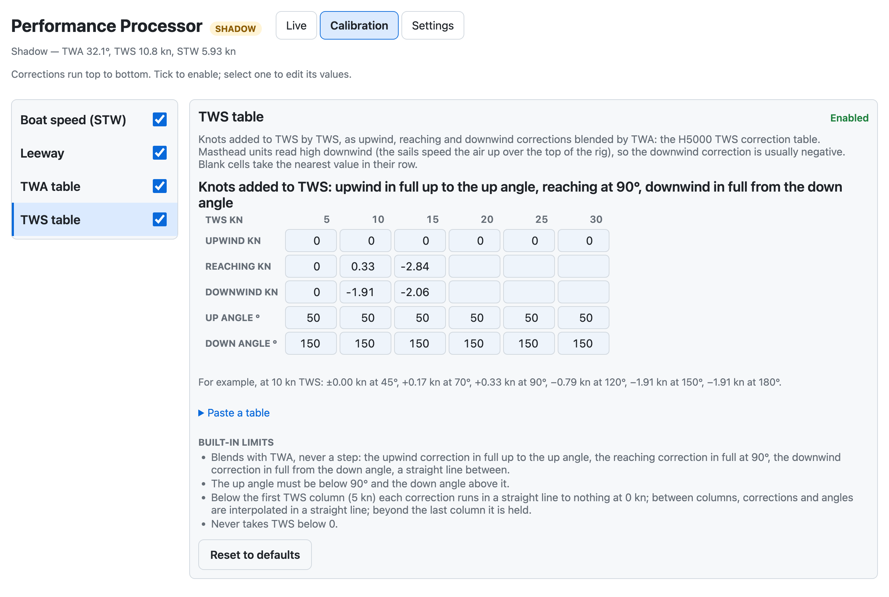

# signalk-performance-processor

**Steady true wind direction through tacks and gybes: true wind calibrated in Signal K, the way a B&G H5000 does it.**

**The problem.** If your TWD swings 5–10° every time you tack or gybe, the wind hasn't shifted: your true wind is miscalibrated. True wind is worked out from apparent wind, boat speed and heading, so it inherits their errors. The masthead reads a bent airflow upwind, the paddlewheel misreads when heeled, and neither error is the same on both tacks. You can't call real shifts, laylines land in the wrong place, and polars and targets get bad numbers.

**What it does.** It works out true wind again in Signal K from raw apparent wind, boat speed and heading, and corrects it as an H5000 does: a boat speed / heel table, then TWA and TWS correction tables, then damping. It publishes corrected TWA, TWS and TWD, with boat speed, leeway, current and ground wind.

**How it is calibrated.** From your own sailing. TWD should not change when the boat tacks or gybes, so every manoeuvre in your logs measures how far TWA is out; TWS should not change when the boat bears away, so each reaching or downwind leg against the beats either side measures how far TWS is out off the wind. boatcal's [`plugincal`](https://github.com/ghotihook/boatcal/tree/main/plugincal) fits the tables from them, and the GPS fits the boat speed table. Paste the result into the webapp, watch each step work live, and run it in **Shadow mode** beside your instruments until you trust it.


## Features

- **The H5000's tables, in the H5000's layout**: boat speed / heel, TWA and TWS. An H5000 calibration can be typed or pasted in cell for cell. The boat speed table adds a 1 kn column, where a paddlewheel stalls (for an H5000 table, fill it with 0.4 × the 2.5 kn value to keep it as it was).
- **Fitted from your own logs** by `plugincal`, and pasted straight into the webapp.
- **Every step visible live**: what each calculation uses, what each correction changed, and what is sent.
- **Damping as on the H5000**, set separately for heading, heel, true wind, boat speed and current.
- **Safe to try**: Shadow mode publishes separate `…Corrected` paths and changes nothing else.
- **Leeway, current and ground wind** as well as true wind.
- **A plain JSON configuration**, easy to back up and compare.

## Requirements

- A Signal K server (2.x) on Node 18 or newer. Replace mode uses the server's **Source Priorities**.
- These inputs in Signal K:

| Input | Path | Needed for |
|---|---|---|
| Apparent wind, **raw** | `environment.wind.angleApparent`, `speedApparent` | everything |
| Boat speed | `navigation.speedThroughWater` | everything |
| Heading | `navigation.headingTrue`, or `headingMagnetic` with `navigation.magneticVariation` | TWD, current, ground wind |
| Heel | `navigation.attitude` (roll) | the STW table's heel rows, leeway |
| SOG, COG | `navigation.speedOverGround`, `courseOverGroundTrue` (or `courseOverGroundMagnetic` + variation) | current, ground wind |

> **Apparent wind must be raw: AWA and AWS as the masthead measures them, uncorrected and undamped.** The plugin applies the calibration and the damping itself. Wind that an instrument has already corrected gets corrected twice, and wind it has already damped lags heading and boat speed, so TWD swings with every yaw. In the instrument, take the wind tables out and set wind damping to 0, or read apparent wind from a source ahead of it. Masthead alignment (an offset fixed on the sensor) is the exception: keep it in the instrument.
>
> **Boat speed** is the paddlewheel with the instrument's boat speed calibration (its speed factor) and nothing else: no heel correction in the instrument.

## Installation

1. In the Signal K admin UI, **Appstore → Available**, search for **Performance Processor**, **Install**, and restart the server when asked.
2. **Server → Plugin Config**: enable **Performance Processor** (it ships disabled).
3. Open **Webapps → Performance Processor**. It starts in Shadow mode with the defaults.

## Getting started

1. **Check the inputs.** The Live page lists every input with its source and age. Each input is read from one sensor, never from another plugin: Auto takes the one with the highest data rate in the first 2 s, not necessarily the most accurate; if another sensor sends the same thing and reads differently, the Live page says so. Choose a different one under **Settings → Input sources** if needed.
2. **Calibrate.** Log some sailing since your setup last changed (rig tune, sails, instrument calibration): 10 or more tacks and gybes in steady wind, some reaching and a few roundings, and windward-leeward laps for the TWS table. Run `python -m plugincal --since <that date>` ([how](https://github.com/ghotihook/boatcal/tree/main/plugincal)), paste each table it prints into the **Calibration** page, and **Save**. By hand, the H5000 rule works unchanged: if TWD lifts on every tack, take half the error off TWA in that cell.
3. **Compare.** Sail in Shadow mode and compare the `…Corrected` paths with your instruments.
4. **Go live** with Replace mode once you trust it: rank this plugin first for each output path in **Server → Source Priorities**, and take the instrument's own TWA / TWS tables out so nothing is corrected twice. This plugin sends true heading too: turn off any other plugin that works it out (such as derived-data's true heading), so one value goes to the whole boat.

Refit after anything that changes the boat or what the instruments read: a rig tune, new sails, a boat speed calibration change, a new masthead unit.

## How it works

One chain per calculation, from its inputs to what it sends. Inputs in *italics* are made by another chain. The Live page shows the same chains with each value now.

| Chain | Uses | Steps | Sends |
|---|---|---|---|
| Heading | compass, variation | magnetic + variation → damping | true heading, with each compass update (not when the heading sensor sends true heading itself) |
| Boat speed | paddlewheel, heel | STW table → damping | STW |
| Leeway | heel, *STW* | K × heel ÷ STW² | leeway |
| True wind | apparent wind, *STW*, heading | apparent wind − STW along the heading → TWA table → TWS table → heading + TWA → damping | TWD, TWS, and TWA as the damped TWD less the heading. TWA goes out with each heading update too, so it follows a tack at the compass's rate |
| Current | SOG, COG, heading, *STW*, *leeway* | ground velocity − water velocity → damping | current |
| Ground wind | *TWD*, *TWS*, *current* | true wind + current → damping | ground wind speed, direction and angle (the angle with each heading update too) |

| Correction | What it does | Default |
|---|---|---|
| STW table | Knots added to the paddlewheel, by heel (rows −20, −10, 0, 10, 20°; + = starboard side down) and boat speed (columns 1, 2.5, 5 … 15 kn), bilinear, the last column held above 15 kn. Below 1 kn the correction runs in a straight line to nothing at 0 kn, so a stopped boat is not given speed. The 1 kn column is not on the H5000: a paddlewheel stalls below about 2 kn and reads up to 0.6 kn low there, which a straight line from 2.5 kn misses, and in light air that is several degrees of TWA. **Edit symmetrically** on the Calibration page keeps port and starboard rows the same | On |
| Leeway | K × heel ÷ STW², capped at 15°, faded in from 1.5 to 3 kn. Used for current, **not** for true wind, as on the H5000 by default: the TWA table takes up its effect | On |
| TWA table | Degrees added to \|TWA\|, in rows at TWA 40° (upwind), 90° (reaching) and 165° (downwind) by TWS 5, 10 … 30 kn, linear between, and from nothing at 0 kn below 5 kn. In full from 30° to 170° TWA, fading to none at 0° and 180°, so TWD passes smoothly through tacks and gybes | On |
| TWS table | Knots added to TWS by TWS 5, 10 … 30 kn, in three rows: the upwind correction in full up to the up angle, the reaching correction at 90°, the downwind correction in full from the down angle, linear between, so it never steps. Up and down angles are rows too, by TWS. The up angle must be under 90° and the down angle over it. (An H5000 with an up angle past 90°, such as 165°, would step at 90°: set the up angle to where upwind sailing ends instead.) Masthead units read high off the wind (the sails speed the air up over the rig), so this mostly takes off | On |

**Damping**, in seconds (0 = none), as on the H5000:

| Value | Default | |
|---|---|---|
| Heading | 0 s | Heading, before true wind. Keep it at apparent wind's lag: 0 for raw apparent wind, or a yaw swings TWD |
| Heel | 2 s | Heel, before the STW table and leeway, from every attitude message at the sensor's rate: takes most of the roll out |
| True wind | 3 s | TWD, TWS and ground wind. TWA is the damped TWD less the heading now, sent with each heading update, so it answers the helm at once |
| STW | 1 s | The published STW |
| Current | 10 s | Current, as a vector |

More true wind damping gives a steadier TWD but shows a real shift later.

**Built in**, with the plugin's own numbers listed in the webapp:

- **Light air.** Below 1.5 kn of TWS, wind direction is noise: TWD and the ground wind direction and angle are not published until TWS is back to 2 kn. TWA, TWS and ground wind speed still are: in light air TWA is what you sail by, so it is never held back.
- **Stale or implausible input.** Inputs older than 3 s are not used. When apparent wind stops nothing is published: Signal K keeps the last values, so the status says so and the Live page greys them out. Apparent wind over 120 kn, STW over 60 kn or heel beyond ±90° is ignored, and the status says why.
- **Heading.** `navigation.headingTrue` from the heading sensor if it sends it; otherwise magnetic heading plus `navigation.magneticVariation` (normally from the GPS); otherwise the fallback variation in Settings.
- **Inputs from sensors, one each.** Unless you choose a source in Settings, every input is read from data connections only, never from another plugin (its value is a copy, later and slower, or already corrected, and in Replace mode it may be this plugin's own output fed back), and from one sensor: for its first 2 s the first seen, then the one sending most often (the highest data rate, not necessarily the most accurate), kept until restart or Save. Two sensors that disagree are never mixed; another sensor reading differently from the one in use is shown on the Live page and in the status. If the sensor in use goes quiet, the input is missing (the status names any other sensor sending it) rather than silently replaced by a sensor the tables were not fitted to.
- **No loops with other plugins**, as above, and no path is published more often than 20 Hz.

## The webapp

**Webapps → Performance Processor.**

- **Live**: the published values, with the undamped and uncorrected ones under them; the pipeline, one row per calculation; every path sent; each input's source and age.
- **Calibration**: the corrections in pipeline order, each with an on/off switch, its table, its built-in limits, **Paste a table** (the text `plugincal` prints, or the same from a spreadsheet), **Copy this table** and **Reset to defaults**. **Save** to apply.
- **Settings**: Shadow or Replace, damping, the fallback variation, and the source for each input: every source seen, with its rate and whether it is another plugin, and which sensor Auto (the highest-rate sensor) is using.

| | |
|---|---|
|  |  |
|  |  |
|  | |

On a phone each row stacks: 

## Outputs

| Output | Shadow mode (default) | Replace mode |
|---|---|---|
| True wind angle | `environment.wind.angleTrueWaterCorrected` | `environment.wind.angleTrueWater` |
| True wind speed | `environment.wind.speedTrueCorrected` | `environment.wind.speedTrue` |
| True wind direction | `environment.wind.directionTrueCorrected` | `environment.wind.directionTrue` |
| True heading (from compass + variation) | `navigation.headingTrueCorrected` | `navigation.headingTrue` |
| Speed through water (STW table on) | `navigation.speedThroughWaterCorrected` | `navigation.speedThroughWater` |
| Leeway (on) | `navigation.leewayAngleCorrected` | `navigation.leewayAngle` |
| Current | `environment.currentCorrected` | `environment.current` (`drift`, `setTrue`) |
| Ground wind speed | `environment.wind.speedOverGroundCorrected` | `environment.wind.speedOverGround` |
| Ground wind angle, from the bow | `environment.wind.angleTrueGroundCorrected` | `environment.wind.angleTrueGround` |
| Ground wind direction | `environment.wind.directionGroundCorrected` | `environment.wind.directionGround` (not in the Signal K schema; sent with `meta`) |

Everything is published under this plugin's own `$source`: STW each time the paddlewheel reports; true heading, TWA and ground wind angle with each heading update; TWA and everything else with each apparent wind update. Shadow paths carry `meta` with their units.

## Configuration

Everything is set in the webapp and saved to `config.json` in the plugin's data directory (`~/.signalk/plugin-config-data/signalk-performance-processor/`), not in the admin **Plugin Config** form. Saving needs write access when Signal K security is on. `plugincal --out` writes a complete `plugin_config.json` that can be copied there (then restart) or sent with `PUT /calibration`.

```json
{
  "schema": 6,
  "mode": "shadow",
  "variation": 12.8,
  "damping": { "heelS": 2, "headingS": 0, "trueWindS": 3, "stwS": 1, "currentS": 10 },
  "sources": { "apparentWind": "", "stw": "", "heading": "", "attitude": "", "gps": "", "variation": "" },
  "corrections": {
    "stw": { "enabled": true, "heel": [-20, -10, 0, 10, 20], "stw": [1, 2.5, 5, …, 15], "add": [[…], […], […], […], […]] },
    "leeway": { "enabled": true, "k": 8.568 },
    "twa": { "enabled": true, "tws": [5, 10, …, 30], "upwind": […], "reach": […], "downwind": […] },
    "tws": { "enabled": true, "tws": [5, 10, …, 30], "upwind": […], "reach": […], "downwind": […], "upAngle": […], "downAngle": […] }
  }
}
```

Blank table cells are `null`; the plugin uses the nearest value in the row, and a row with none takes the nearest row. The table axes are fixed (the H5000's 2018 layout, with a 1 kn boat speed column): a file from an earlier release keeps its settings, leeway K and any table whose layout still fits. From 0.2.7 to 0.2.11 that is every table: the boat speed table gets a 1 kn column set so it works exactly as before, and the status asks for a refit until you Save. From 0.2.6 the TWA table, and from 0.1.0 to 0.2.5 all three, are reset to the defaults and the plugin runs in Shadow mode until you refit them with `plugincal` and Save (the status says so). A file with any other layout is refused with the reason, and so is a file from a newer release, which is never overwritten.

**The defaults are the author's boat** (before its 2026 rig tune), fitted by `plugincal`. They will be wrong for yours: refit, or use **Reset to defaults** and enter your own.

## Limitations

- **Your instrument displays show the instrument's numbers.** The plugin publishes into Signal K only. To see its values on the boat's displays, forward them to NMEA 2000 (for example with `signalk-to-nmea2000`). If you forward STW or true heading, choose your paddlewheel and compass as the STW and heading sources in Settings: a value coming back from the bus would otherwise look like a sensor, and Auto could pick it and correct it again.
- **Damped apparent wind needs damped heading.** If your apparent wind arrives damped by the instrument, damp heading to the same lag, so a yaw does not swing TWD on the Live page.
- **Current is a trend, not a live number.** It is the small difference between two vectors of about boat speed, so 1% of boat speed or 1° of heading makes 0.1 kn of current, and a paddlewheel's error changes from day to day. Read it averaged over both tacks of a beat.
- **Absolute TWS and TWD** (a masthead offset, an AWS scale error) are the same on both tacks, so they cannot be fitted from tacks and gybes: set them in the instrument. The TWS table corrects TWS off the wind *relative to upwind*; it cannot tell whether the upwind reading itself is right.

## Troubleshooting

The plugin's status line (in the admin UI and at the top of the webapp) says what it is doing.

| Status | Meaning |
|---|---|
| Waiting for apparent wind | No `angleApparent` / `speedApparent` yet from the sensor in use (or the chosen source) |
| No apparent wind for N s: nothing published | Apparent wind stopped. Nothing is published, but Signal K keeps the last values, so displays may still show them: the Live page greys them out |
| Waiting for speed through water | No STW in the last 3 s |
| (X sends it: choose it in Settings) | After any missing input: another sensor sends it. Auto keeps the sensor it chose at start, so choose X if it is the right one |
| (only from X, another plugin: …) | After any missing input: only another plugin sends it, which is ignored unless chosen (derived-data's COG true or true heading, another STW corrector). Choose it in Settings, or better, read the sensor it is made from |
| Not publishing — … is not plausible | An input is out of range (a sensor fault); nothing is published from it |
| … light air … | TWS is below 1.5 kn: TWD and ground wind direction are held back until 2 kn; TWA still goes out |
| … no heel / no heading / no SOG/COG | Running without that input: no heel correction or leeway / no TWD, current or ground wind / no current or ground wind. As above, it names anything else sending it |
| … X reads +4.6° … from Y (not used …) | Two sensors send the same input and disagree. Y is in use; check which is right and choose it in Settings |
| Rate limited … | Something is updating faster than 20 Hz, usually a loop with another plugin; the status names its source |
| Configuration: … | The saved configuration is invalid; the message says why, in the admin UI and as "Plugin not running: …" in the webapp. Fix it in the webapp |
| Upgraded from an earlier release … | A configuration saved by an earlier release: its settings are kept, the tables it names are reset to the defaults, and Shadow mode is on. Refit them with `plugincal` and Save |

## API

Under `/plugins/signalk-performance-processor`:

- `GET /calibration`: the configuration in use, the defaults, and the built-in limits.
- `PUT /calibration`: validate, save and restart with a new configuration; 400 with the reasons if it is invalid.
- `GET /live`: the latest result, each step, input ages, the sources seen, and `error`: why the plugin is not running, if it is not.

## Development

```bash
npm test          # node --test
cd ~/.signalk && npm install /path/to/signalk-performance-processor && sudo systemctl restart signalk
```

`lib/processor.js` is the calculation, free of Signal K so it can be tested and replayed (`plugincal` runs it directly). Each correction is an entry in its `CORRECTIONS`, with its defaults in `lib/defaults.js` and its editor in `public/app.js`. `public/tables.js` is the table layout and text format, shared by the plugin, the webapp and `plugincal`. `lib/damping.js` is the damping; `index.js` the Signal K side.

What changed in each release: [CHANGELOG.md](CHANGELOG.md).

## Licence

MIT
